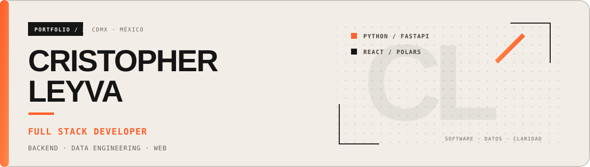

  

  
  
  

  Transformo datos complejos en plataformas claras, rápidas y confiables. 
  Desarrollo APIs, pipelines de datos e interfaces web con <strong>Python, FastAPI, React y Polars</strong>.

<table align="center">
  <tr>
    <td align="center"><strong>10M+</strong> registros por lote</td>
    <td align="center"><strong>Full Stack</strong> backend + frontend</td>
    <td align="center"><strong>Data Engineering</strong> pipelines y automatización</td>
    <td align="center"><strong>Español · EN B2</strong> comunicación</td>
  </tr>
</table>

## 👨‍💻 Sobre mí

- 💼 Full Stack Developer en la **Comisión Nacional Bancaria y de Valores (CNBV)**.
- ⚙️ Diseño microservicios y APIs RESTful de alto rendimiento con **FastAPI**.
- 📊 Proceso y cruzo grandes volúmenes de datos con **Polars, Pandas y SQL**.
- 🖥️ Construyo interfaces responsivas con **React y Tailwind CSS**.
- 🚀 Trabajo con despliegues, CI/CD y entornos **Linux, Azure y Vercel**.
- 🎓 Estudio Ingeniería en Sistemas Computacionales en **UNITEC**.

## 🚀 Proyectos destacados

<table>
  <tr>
    <td width="50%" valign="top">
      <h3>◼ Balam-Ha</h3>
      
Motor de validaciones normativas y auditoría para lotes masivos de datos financieros.

      
<code>FastAPI</code> <code>React</code> <code>Polars</code> <code>Azure</code>

      Procesamiento de hasta <strong>10 millones de registros</strong>.
    </td>
    <td width="50%" valign="top">
      <h3>◼ Nexus DGAA</h3>
      
Plataforma para centralizar la evaluación de incumplimientos y el cálculo de sanciones.

      
<code>FastAPI</code> <code>React</code> <code>Polars</code> <code>SQL Server</code>

      Flujos centralizados con trazabilidad operativa.
    </td>
  </tr>
  <tr>
    <td width="50%" valign="top">
      <h3>◼ DocHub</h3>
      
SPA para indexación de expedientes, aprobaciones y seguimiento de hallazgos.

      
<code>JavaScript</code> <code>Python</code> <code>SQLite</code> <code>Tailwind</code>

      Sincronización automatizada de directorios en red.
    </td>
    <td width="50%" valign="top">
      <h3>◼ <a href="https://www.cristopher-aml.dev/">Portafolio</a></h3>
      
Sitio profesional con experiencia, proyectos, casos de estudio y stack técnico.

      
<code>Astro</code> <code>TypeScript</code> <code>Tailwind CSS</code>

      <a href="https://github.com/CristopherAML/portfolio-2026">Código</a> · <a href="https://www.cristopher-aml.dev/">Sitio en vivo</a>
    </td>
  </tr>
</table>

> [!NOTE]
> Algunos proyectos profesionales no tienen código público por la naturaleza de la información que procesan.

## 🧰 Stack técnico

  

  
  
  
  
  

## 🎓 Formación y certificaciones

| Formación | Certificaciones |
| --- | --- |
| **Ingeniería en Sistemas Computacionales** Universidad Tecnológica de México (UNITEC) | **Google:** Fundamentos de Ciberseguridad y Desarrollo Móvil **Microsoft:** Analista de Datos **IBM:** Analista de Datos |

---

<h3 align="center">Construyamos lo siguiente.</h3>

  ¿Tienes un proyecto, una oportunidad o una idea? 
  <a href="mailto:cristopherleyva9@gmail.com"><strong>Hablemos →</strong></a>

